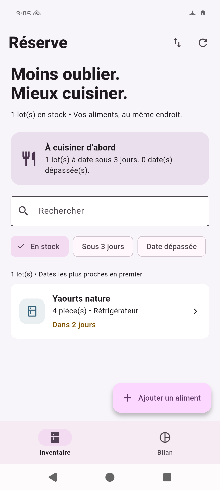
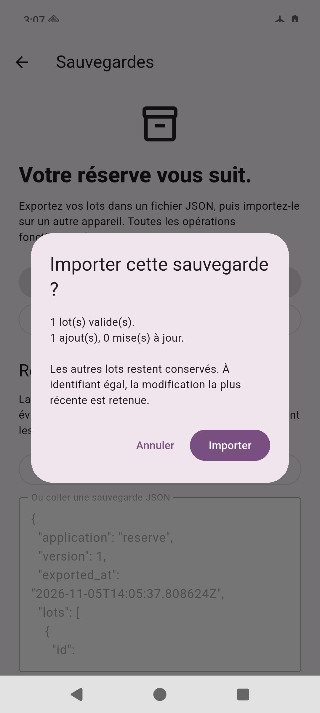

# Réserve — garde-manger hors ligne

**Moins oublier. Mieux cuisiner.** Réserve aide les étudiants et petits foyers à retrouver leurs aliments et à utiliser en priorité les lots dont la date approche. On ajoute une quantité, un emplacement et la date de l'emballage, puis on suit ce qui a été consommé ou jeté. L'application démarre vide, sans compte ni connexion.

## Installer pour corriger le projet

**[Télécharger l'APK Android signé — version 1.0.0](https://github.com/NicolasBellina/reserve-flutter/releases/download/v1.0.0/reserve-1.0.0.apk)** · [Page de la livraison](https://github.com/NicolasBellina/reserve-flutter/releases/tag/v1.0.0)

L'APK fonctionne sur Android 7.0 / API 24 ou supérieur. Il contient ARM 32 bits, ARM64 et x86_64. **Sur Windows, il se lance dans un émulateur Android** : démarrer un téléphone virtuel dans Android Studio, puis glisser l'APK sur son écran. Flutter et le code source ne sont pas nécessaires pour cette installation. La [notice Windows](docs/INSTALLATION_WINDOWS.md) détaille la procédure et le scénario de correction.

Le même APK a été installé et testé sur un émulateur Android 16 ARM64, avec mode avion activé, Wi-Fi et données mobiles désactivés. La signature et l'alignement des bibliothèques ont été vérifiés. Les essais ont été réalisés sur Mac ; l'installation sur Windows n'est pas présentée comme un test déjà exécuté.

## Ce que l'application permet

- Créer, consulter, modifier et supprimer un lot après confirmation ; refuser les champs obligatoires vides et les quantités invalides.
- Chercher par aliment, note ou emplacement, avec recherche insensible aux accents courants ; combiner cette recherche aux filtres de statut ou d'échéance.
- Ranger au réfrigérateur, au congélateur ou au placard ; distinguer En stock, Consommé et Jeté.
- Consulter un bilan global : stock par lieu, dates proches/dépassées, lots consommés/jetés et part consommée parmi les lots terminés.
- Conserver ses données après arrêt de l'application et transférer son inventaire avec une sauvegarde JSON.

L'interface Material 3 est en français, défilante et adaptée au clavier. Chargement, inventaire vide, absence de résultats et erreurs ont des états explicites. En cas d'échec d'enregistrement, le formulaire conserve la saisie. Les lots des captures ont été créés pendant la recette et ne sont pas inclus dans la base distribuée.

## Architecture et décisions techniques

Le flux est **page → contrôleur → repository → SQLite → mise à jour de l'état → widgets**. Aucune page n'exécute de SQL.

| Choix | Pourquoi ce choix dans Réserve |
|---|---|
| **Flutter / Dart avec null safety, Material 3** | Une interface mobile cohérente avec formulaires, navigation et composants accessibles. Les enums et le modèle immuable rendent les statuts et emplacements explicites. Les traductions viennent de `flutter_localizations`, sans police ni ressource distante au lancement. |
| **SQLite avec `sqflite` et `path`** | Les lots sont structurés et doivent rester disponibles hors ligne. SQLite conserve identifiants et dates, permet les requêtes paramétrées et garantit la transaction d'import. `path` construit le chemin du fichier sans le coder pour un système précis. Le schéma initial est versionné en v1. |
| **`ChangeNotifier` et `ListenableBuilder`** | Un seul inventaire partagé entre quelques écrans suffit à ce mécanisme Flutter. Le contrôleur centralise chargement, filtres, calculs et erreurs. Il est créé une fois et libéré avec le timer et le repository ; les champs de texte sont libérés par leurs pages. |
| **Repository injectable** | L'interface et le contrôleur ne dépendent pas du pilote. Les tests de widgets simulent les erreurs ; les tests SQLite exécutent les vraies transactions sur disque. Cette séparation reste courte et suit les responsabilités du sujet. |
| **JSON versionné et canal natif Kotlin** | L'export/import sert au transfert et à la sauvegarde sans serveur. Les deux actions fichiers passent par le sélecteur Android, sans permission générale de stockage. Un petit canal natif couvre ce besoin sans ajouter de package de fichiers. |
| **Pilotes SQLite complémentaires** | `sqflite_common_ffi` sert aux tests sur disque et `sqflite_common_ffi_web` à l'aperçu navigateur. Le repository reste commun. Le lockfile fixe les dépendances, dont la version récente de `sqlite3` utilisée par ces pilotes. |

```text
lib/models/      Lot typé, ID stable de 128 bits, création et modification
lib/data/        Contrat, schéma et opérations SQLite
lib/state/       ChangeNotifier, états, recherche, filtres et bilan
lib/services/    Validation JSON et canal de documents
lib/ui/          Inventaire, fiche, formulaire, bilan et sauvegardes
android/         Sélecteur de fichiers et configuration de signature
```

### Une sauvegarde qui se fusionne sans doublon

L'import valide **tout le fichier avant d'écrire** : format Réserve v1, identifiants uniques, dates réelles, statuts et quantités valides. Un aperçu annonce les ajouts et modifications. À identifiant égal, seule la version strictement plus récente remplace le lot. La fusion est transactionnelle : une erreur annule l'ensemble. Réimporter le même fichier ne crée aucun doublon. Les limites sont de 2 Mo UTF-8 et 5 000 lots.

### Compromis assumés

La liste est chargée en mémoire, ce qui convient à un garde-manger personnel. Le bilan compte des **lots**, pas un poids total mélangeant pièces et grammes. Les sauvegardes sont en clair, manuelles et sans synchronisation automatique ; une ancienne sauvegarde peut réintroduire un lot supprimé. La résolution des conflits suppose des horloges correctes. Les dates restent des repères saisis, pas une évaluation de sécurité alimentaire. La base Web est distincte de celle du téléphone ; iOS et une application Windows native ne sont pas fournis.

## Vérifications et démonstration

**Analyse sans problème et 22 tests réussis : 16 unitaires/SQLite et 6 widgets.** Ils couvrent notamment le CRUD, les validations, la recherche, les erreurs récupérables, la persistance après réouverture et l'annulation d'un import en échec.

La recette sur l'APK release Android a aussi vérifié les fichiers natifs, les annulations, la restauration après suppression, les conflits, les refus de fichiers invalides ou > 2 Mo et la conservation des données après arrêt forcé.

- [Résultats et journaux](docs/VERIFICATION.md) · [Compte rendu Android](docs/android/RECETTE_EXECUTEE.md)
- [Recette à reproduire](docs/RECETTE.md) · [Trame de présentation sur téléphone](docs/PRESENTATION.md)

 

## Lancer les sources

Environnement vérifié : Flutter **3.47.9 stable**, Dart **3.13.7**, Java **21**, Android SDK **36**, AGP **9.1.0** avec Kotlin intégré. Utiliser Flutter 3.47 ou supérieur.

```sh
git clone https://github.com/NicolasBellina/reserve-flutter.git
cd reserve-flutter
flutter pub get
flutter run -d <identifiant-android>
flutter analyze
flutter test --reporter expanded
```

Sur le Mac de développement, `./tool/flutterw` retrouve aussi le SDK temporaire et `./tool/build_apk` reconstruit la livraison. `./tool/run_web` lance un aperçu local. La première compilation nécessite le téléchargement des dépendances ; l'application installée fonctionne hors connexion.

Les clés, mots de passe de signature, bases, SDK et dossiers générés sont exclus de Git. L'APK est joint à la release. Pour reconstruire une version signée et sauvegarder la clé locale, voir [LIVRAISON.md](docs/LIVRAISON.md).
