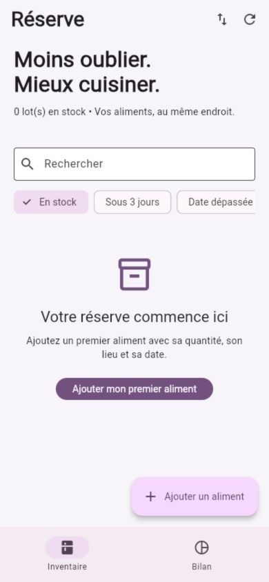
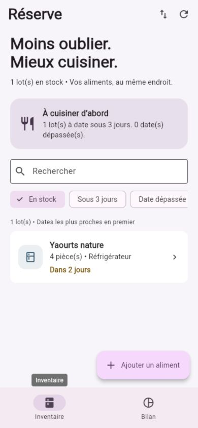
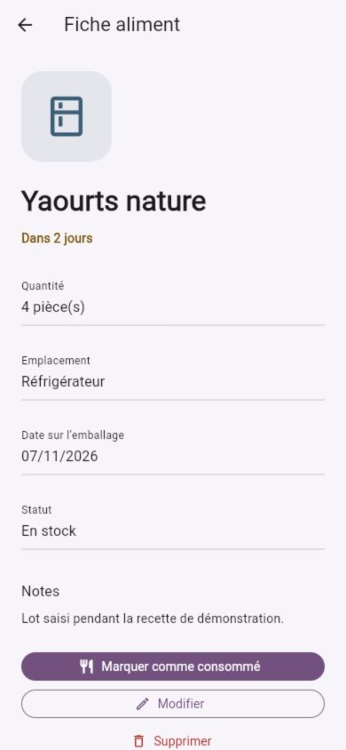

# Réserve — projet final Flutter

**Moins oublier. Mieux cuisiner.** Réserve est un garde-manger personnel pour les étudiants et petits foyers qui oublient des aliments au fond du réfrigérateur. L'utilisateur ajoute un lot avec sa quantité, son emplacement et la date de l'emballage, retrouve les échéances proches puis indique ce qui a été consommé ou jeté. Aucun compte ni connexion n'est nécessaire.

Ce projet est distinct de Piste : modèle de lots alimentaires, gestion de dates, emplacements de conservation, bilan de consommation et sauvegardes structurées. La base est **vide au premier lancement**. Les aliments visibles dans les captures ont été saisis pendant la recette ; ils ne sont pas injectés dans l'application.

## Essayer l'application

L'APK prêt à installer est **[livraison/reserve-1.0.0.apk](livraison/reserve-1.0.0.apk)**. Il est compilé en release et signé avec la clé privée propre à Réserve. Android 7.0 / API 24 minimum. Voir la [notice d'installation et de signature](docs/LIVRAISON.md).

```sh
cd projet_final
flutter pub get
flutter run -d <identifiant-android>
```

Projet vérifié avec **Flutter 3.47.9 stable / Dart 3.13.7**, Java 21 fourni par Android Studio, Android SDK 36 et AGP 9.1.0 avec Kotlin intégré. Le minimum de ce projet est Flutter 3.47 / Dart 3.12 à cause de la configuration Android et du pilote SQLite Web. `pubspec.lock` fixe les versions utilisées.

Sur ce Mac, les scripts retrouvent aussi le SDK temporaire déjà installé :

```sh
./tool/flutterw analyze
./tool/flutterw test --reporter expanded
./tool/build_apk
./tool/run_web
```

Le dernier script ouvre un serveur local à [http://127.0.0.1:8090](http://127.0.0.1:8090), à visiter dans un navigateur. Le premier build peut télécharger des dépendances ; l'application compilée reste utilisable sans réseau. Android est la cible du rendu. La version Web est une aide à la démonstration, avec SQLite WebAssembly et IndexedDB ; sa base est distincte de celle du téléphone. Garder la même origine pour la retrouver. iOS n'est pas inclus.

## Fonctionnalités

- Inventaire, détail, création/édition et bilan, avec interface Material 3 en français.
- CRUD complet ; suppression confirmée ; retour de succès ; conservation de la saisie si l'enregistrement échoue.
- Nom et date obligatoires ; quantité entière entre 1 et 999 999 ; limites des textes ; lieux Réfrigérateur / Congélateur / Placard.
- Statuts En stock, Consommé et Jeté. Action directe « Marquer comme consommé » dans la fiche ; les autres transitions passent par Modifier.
- Recherche insensible à la casse et aux accents courants, sur nom, notes et emplacement ; filtres combinables par statut ou échéance.
- Tri par date ; repérage des dates dépassées et des dates entre aujourd'hui et trois jours inclus. Les dates sont comparées par jour civil, sans erreur lors d'un changement d'heure.
- Bilan sur tous les lots : stock par emplacement, échéances, consommés, jetés et pourcentage consommé parmi les lots terminés. Aucune addition de quantités ayant des unités différentes.
- États loading / success / empty / error visibles, bouton Réessayer, traitement des erreurs asynchrones et verrouillage des doubles opérations.
- SQLite local ; identifiant aléatoire stable de 128 bits ; création et modification conservées. Actualisation des échéances au retour dans l'application et chaque minute.

## Fonctionnalité technique distinctive : sauvegarde JSON

Sur Android, les boutons **Enregistrer le fichier JSON** et **Choisir un fichier JSON** ouvrent le sélecteur système via un canal Flutter/Kotlin. Ils utilisent `ACTION_CREATE_DOCUMENT` / `ACTION_OPEN_DOCUMENT`, sans permission générale de stockage. Les accès disque sont effectués hors du thread UI. Les annulations et erreurs sont gérées. Un choix local comme Téléchargements fonctionne hors connexion ; un fournisseur cloud affiché par Android peut nécessiter Internet.

Sur toutes les cibles fournies, copier le JSON et coller une sauvegarde est également possible. Le format contient `application: reserve`, `version: 1`, une date d'export et les lots typés. Le lecteur refuse les fichiers malformés, les identifiants dupliqués, les dates impossibles, les statuts inconnus et les quantités invalides. Limites : 2 Mo UTF-8 et 5 000 lots par fichier.

Avant confirmation, l'utilisateur voit le nombre d'ajouts et de mises à jour. L'import **fusionne** dans une transaction SQLite : identifiant absent → ajout ; identifiant présent → seule une modification strictement plus récente remplace le lot. Une seconde importation du même fichier ne duplique rien. En cas d'erreur SQL, toute la transaction est annulée. Ce n'est pas un remplacement complet de base : un lot supprimé peut être réintroduit par une ancienne sauvegarde. Les horloges des appareils doivent être correctes. Le JSON n'est pas chiffré et aucune sauvegarde automatique distante n'est effectuée.

Les tests ciblent l'aller-retour JSON, les refus, la fusion, les conflits et le rollback réel SQLite. La [recette reproductible](docs/RECETTE.md) couvre aussi les fichiers Android.

## Architecture et choix techniques

```text
lib/
  main.dart                       Thème, injection et cycle de vie
  models/food_lot.dart             Lot immuable, enums, dates et validation
  data/lot_repository.dart         Contrat, schéma et opérations SQLite
  data/repository_native.dart      Pilote sqflite Android
  data/repository_web.dart         Pilote SQLite WebAssembly
  state/pantry_controller.dart     ChangeNotifier, états, filtres, calculs
  services/backup_codec.dart       Format JSON versionné et validation
  services/document_service.dart   Canal vers le sélecteur Android
  ui/                             Accueil, fiche, formulaire, bilan, sauvegardes
android/.../MainActivity.kt        Lecture/écriture des documents choisis
```

Flux : **page → contrôleur → repository → SQLite → état mémoire → notifyListeners → pages**. Les pages ne contiennent aucune requête SQL. La sauvegarde JSON est indépendante de l'interface et du stockage ; le canal natif n'écrit jamais dans la base.

1. **Pourquoi SQLite ?** Données structurées, identifiants et dates persistants, transactions pour l'import, disponibilité hors ligne. `sqflite` utilise le pilote natif et `path` construit le chemin. Le schéma initial est versionné en v1 avec index d'échéance ; une évolution nécessitera un `onUpgrade` transactionnel. Aucune migration fictive n'est revendiquée.
2. **Pourquoi ChangeNotifier ?** L'état est limité à un inventaire personnel ; l'outil Flutter suffit, sans dépendance d'état supplémentaire. Le contrôleur est créé une seule fois dans la racine et libéré à sa destruction, ainsi que le timer, l'observateur de cycle de vie et le repository. Les pages utilisent `ListenableBuilder` et libèrent leurs champs de saisie.
3. **Pourquoi ces dépendances ?** `flutter_localizations` fournit les composants français ; `sqflite_common_ffi_web` permet la démonstration Web en réutilisant le repository ; `sqflite_common_ffi` exécute les vraies requêtes sur disque dans les tests. `sqlite3` est explicitement contraint à une version récente compatible pour éviter une ancienne archive native dont l'empreinte téléchargée ne correspondait plus à celle attendue. La signature n'a pas été contournée. Le canal natif évite un package supplémentaire pour seulement deux actions fichiers. Les paquets transitifs sont consignés dans le lockfile.

Compromis : inventaire intégralement chargé en mémoire, adapté à un usage personnel mais pas à une base industrielle. Pas de synchronisation automatique, de rappels système ni de scanner de codes-barres. Le bilan compte des lots, pas des kilos évités. Les dates sont des repères saisis par l'utilisateur et ne constituent pas un contrôle de sécurité alimentaire.

## Qualité et preuves

**22 tests réussis : 16 tests unitaires / SQLite et 6 tests de widgets.** `flutter analyze` ne signale aucun problème. Les scénarios incluent persistance après réouverture, import atomique, filtre et recherche, loading / empty / error, formulaire validé, CRUD d'interface, refus JSON, échec d'écriture récupérable et petit écran avec texte agrandi.

- [Résultats et limites de vérification](docs/VERIFICATION.md)
- [Sortie flutter analyze](docs/flutter-analyze.txt) et [sortie flutter test](docs/flutter-test.txt)
- [Recette manuelle sur Android et scénario d'échec](docs/RECETTE.md)
- [Trame de présentation sur téléphone](docs/PRESENTATION.md)
- [Signature de l'APK](docs/apk-signature.txt) et [alignement des bibliothèques](docs/apk-alignement.txt)

Captures authentiques de la version Web exécutée dans un viewport de 390 × 844, prises le 5 novembre 2026. Ce ne sont pas des captures d'émulateur Android. Le test sur appareil Android, notamment le sélecteur natif, reste à réaliser avant soutenance ; il n'est pas présenté comme réussi.

| Premier lancement | Inventaire saisi | Fiche |
|---|---|---|
|  |  |  |

## Sécurité et livraison

Aucun compte, API, secret distant ou permission de caméra, réseau ou localisation n'est nécessaire en release. La permission interne de réception Android est ajoutée par AndroidX. Les fichiers choisis passent par le sélecteur système. Les valeurs SQL sont paramétrées. Les notes et noms sont locaux ; l'export les contient en clair.

La clé de diffusion `.private/reserve-release.p12` et ses mots de passe dans `android/key.properties` sont ignorés par Git et doivent être sauvegardés séparément. Le dossier `build/`, les SDK, les bases et les caches sont aussi exclus. L'APK est livré localement dans `livraison/` et ignoré pour garder le dépôt source léger ; le joindre au rendu ou à une release du dépôt.

Le dépôt Git local est indépendant de celui de Piste. Il contient des commits correspondant aux étapes réellement effectuées. Aucun dépôt distant n'a été publié.

Références : [ChangeNotifier et état Flutter](https://docs.flutter.dev/data-and-backend/state-mgmt/simple), [sqflite](https://pub.dev/packages/sqflite), [Storage Access Framework Android](https://developer.android.com/training/data-storage/shared/documents-files), [Kotlin intégré dans Flutter](https://docs.flutter.dev/release/breaking-changes/migrate-to-built-in-kotlin/for-app-developers).
